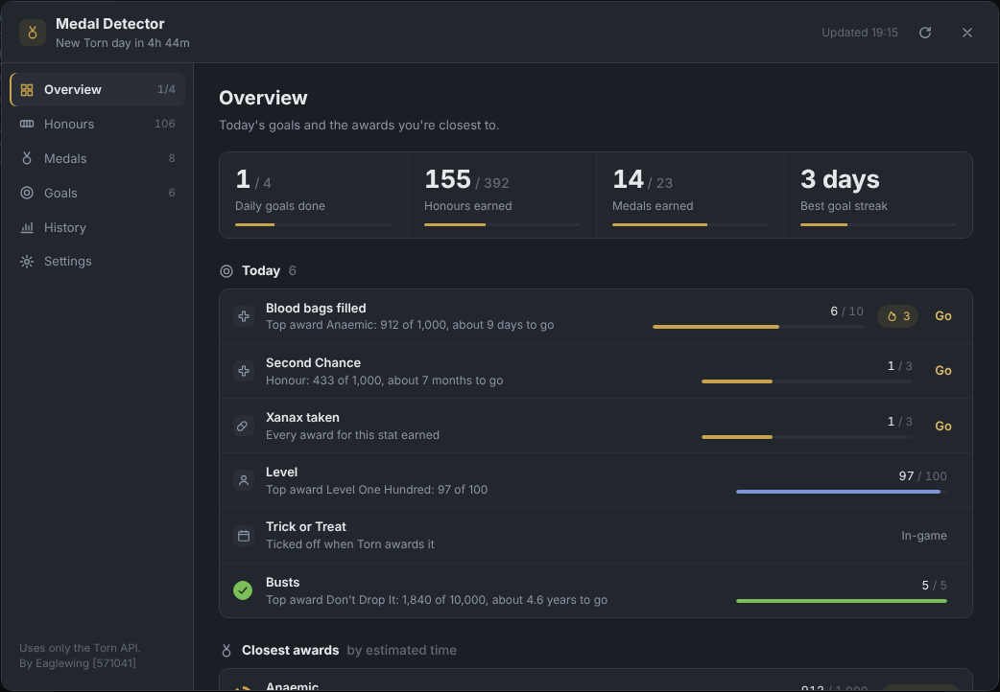
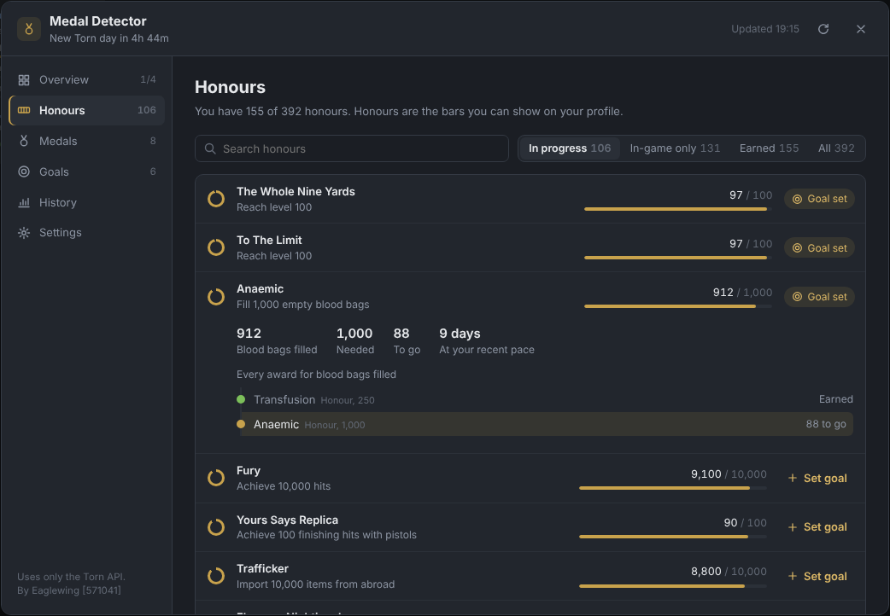
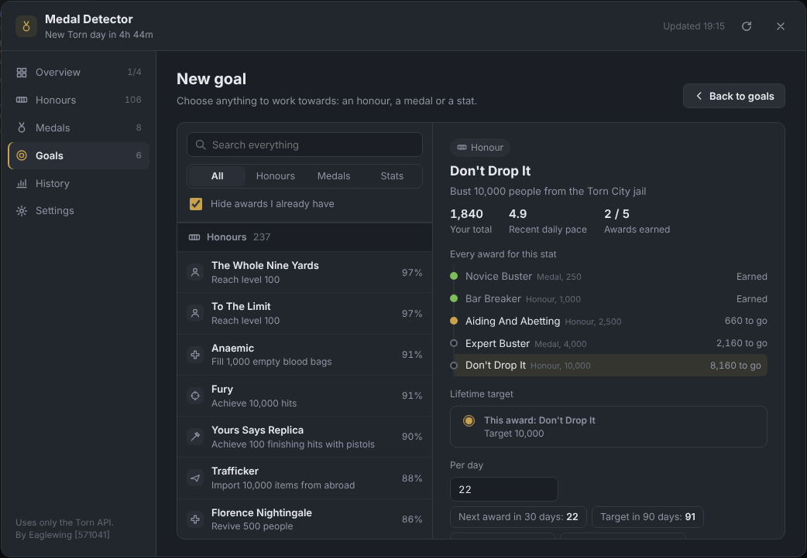
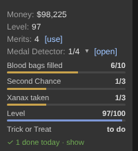
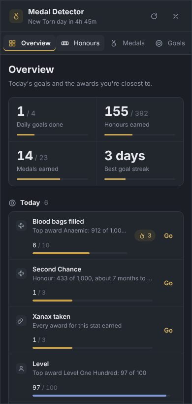

# Medal Detector

Track every Torn honour and medal, see your next award for each stat, and set daily goals to get there. Medal Detector is a userscript for [Torn](https://www.torn.com) that uses only the official Torn API.

Screenshots use sample data.

## Install

1. Install [Tampermonkey](https://www.tampermonkey.net/) for your browser.
2. Open **[medal-detector.user.js](https://raw.githubusercontent.com/Eaglewing91/Medal-Detector/main/medal-detector.user.js)** and click **Install** in Tampermonkey.
3. Load any Torn page. A **Medal Detector** row appears in the sidebar, just under **Merits**. Click **[open]**. On phones, tap the **medal button** in the bottom-right corner instead.
4. Go to **Settings**, follow **Create a Limited key for Medal Detector**, and paste the key in.

Updates install automatically through Tampermonkey.

### Torn PDA

1. In Torn PDA, open **Settings → Advanced browser settings → User scripts** and add a new script.
2. Choose to load it from a URL and use the [install link](https://raw.githubusercontent.com/Eaglewing91/Medal-Detector/main/medal-detector.user.js), or paste the script's code.
3. Open Torn in PDA's browser and tap the **medal button** in the bottom-right corner.

Medal Detector uses the API key you've already set up in Torn PDA, so there's nothing to paste. PDA needs to allow that key the access levels listed under Terms of service below; if it doesn't, add a Limited key in Medal Detector's Settings instead. Reminders aren't available in PDA, because it shows notifications as pop-up boxes.

> **Upgrading from Merit Hunter?** Medal Detector is the same script under a new name, so Tampermonkey installs it as a new script. Remove Merit Hunter, then add your API key and goals again in Medal Detector.

## What it does

### Honours and medals
Separate pages for honours and medals, each with search and filters for **In progress**, **In-game only**, **Earned** and **All**. Click any award to see your numbers, every award on the same path, and how long it will take at your recent pace.

### Goals for anything
**New goal** lists every honour, every medal and every stat in one searchable list. Pick one to see:

- where you are now and every award on the way
- a choice of target: that award, the top award for the stat, your own number, or none
- suggested daily amounts, and how long each would take

Awards the API can't count (casino wins, events, Crimes 2.0 skills and so on) can be goals too. They're ticked off automatically when Torn awards them.

### Daily tracking
Daily progress counts from 00:00 TCT using your real stats, with streaks, a 14-day history, and an optional reminder before the day ends. Your goals also show in the sidebar, and finished ones are hidden.

  
  

### Drug cooldowns
Drug goals know each drug's cooldown range. They show the fastest realistic time to each award and warn you if a daily target is more than the cooldown allows.

| Drug | Cooldown | Most per day |
|---|---|---|
| Ketamine | 45m – 1h | 24 – 32 |
| Cannabis | 1h – 1h 30m | 16 – 24 |
| Opium | 2h – 3h | 8 – 12 |
| Shrooms | 3h 2m – 3h 57m | 6 – 7 |
| Ecstasy | 3h 20m – 3h 50m | 6 – 7 |
| Vicodin | 4h – 6h | 4 – 6 |
| Speed | 4h 10m – 5h 52m | 4 – 5 |
| PCP | 4h 20m – 6h 40m | 3 – 5 |
| Xanax | 6h – 8h | 3 – 4 |
| LSD | 6h 40m – 7h 30m | 3 |

Source: the [Torn wiki](https://wiki.torn.com/wiki/Drug). Overdosing can make cooldowns much longer.

## How awards are matched

Medal Detector downloads Torn's full award list from the API once a day. It matches each description to the stat that counts it, for example "Bust 2,500 people" to busts. New awards appear automatically.

All 392 current honours have been checked by hand against their real wording.

- **184 honours** show live progress.
- **208** can't be counted from any API stat. They're listed under **In-game only**, grouped by type, and can still be added as goals.

If an award looks wrong, please [open an issue](https://github.com/Eaglewing91/Medal-Detector/issues/new?template=award-mismatch.md) with its name and description.

**Known limits**
- The API's theft, cybercrime, fraud, points sold and stock payout counters are legacy fields and may not keep up with the game. The cards for those stats say so.
- Torn's API can run up to about 30 seconds behind the game.

## Torn scripting rules

Medal Detector follows Torn's rules for scripts:

- **API only.** Every request goes to `api.torn.com`. It never requests Torn pages or reads pages you aren't viewing.
- **No automation.** It never clicks, submits or changes anything in the game. Links in the window only navigate when you click them.
- **Automatic checks are API-only.** It checks your stats on page loads, a few seconds after you click something in Torn, when you return to the tab, and on a timer. That's never more than once every 15 seconds, shared across all your tabs. It listens for your clicks but never sends them anywhere.
- No outside websites, no websockets, no `eval`, and no hidden code.

## Terms of service

| | |
|---|---|
| **Data Storage** | Only locally (Tampermonkey storage on this device) |
| **Data Sharing** | Nobody |
| **Purpose of Use** | Personal gain: tracking your own goals and merit milestones |
| **Key Storage & Sharing** | Stored / Used only for automation (sent only to api.torn.com) |
| **Key Access Level** | Limited (user: personalstats, profile, honors, medals, battlestats, workstats, education, perks; torn: honors, medals) |

In Torn PDA, Medal Detector uses the key PDA provides and doesn't store it. A key you paste into Settings is stored on your device as above.

This table is also shown in the script's Settings page, where you enter your key. Your key and data never leave your device except to go to `api.torn.com`.

## Changelog

See [CHANGELOG.md](CHANGELOG.md).

## Licence

[MIT](LICENSE) © 2026 Eaglewing [571041]

Questions or ideas? Message [Eaglewing [571041]](https://www.torn.com/profiles.php?XID=571041) in Torn or [open an issue](https://github.com/Eaglewing91/Medal-Detector/issues).
